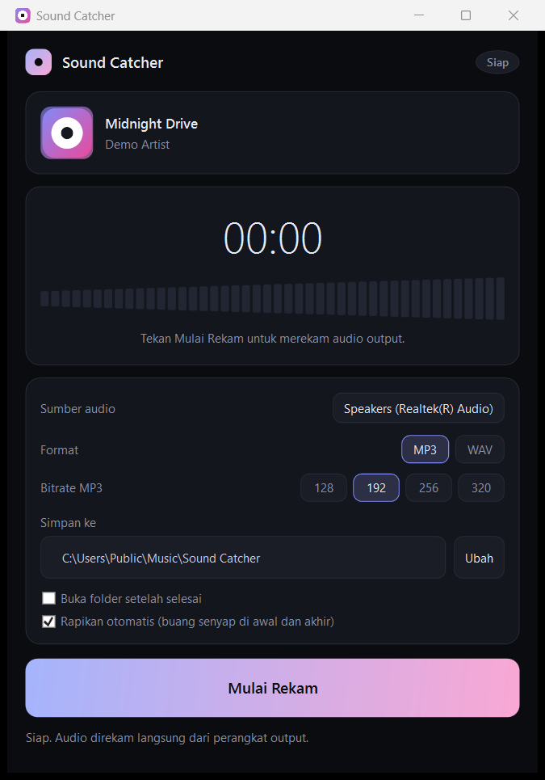
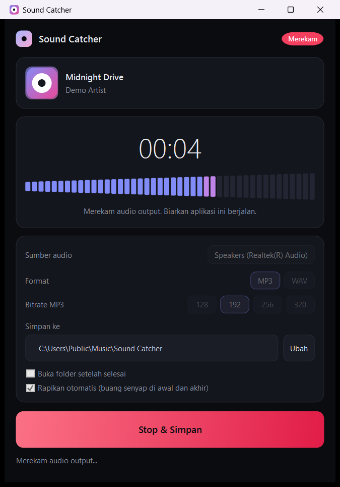
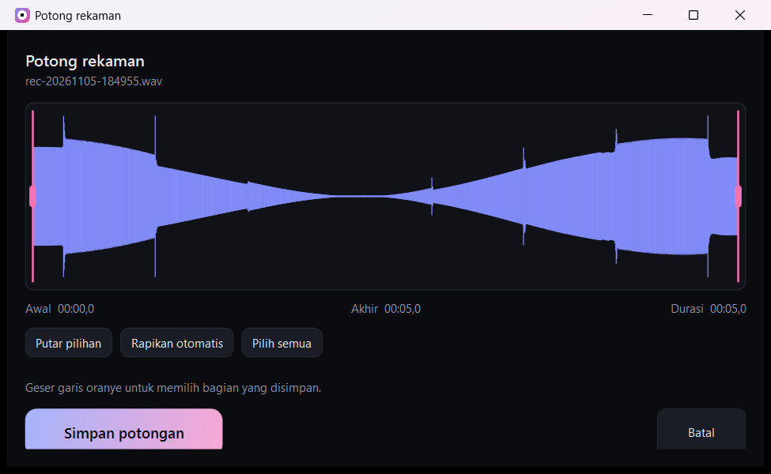
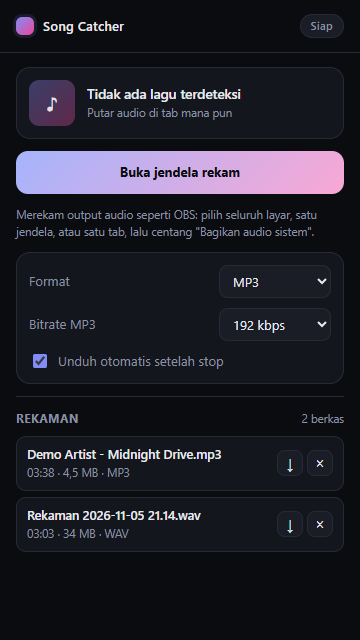
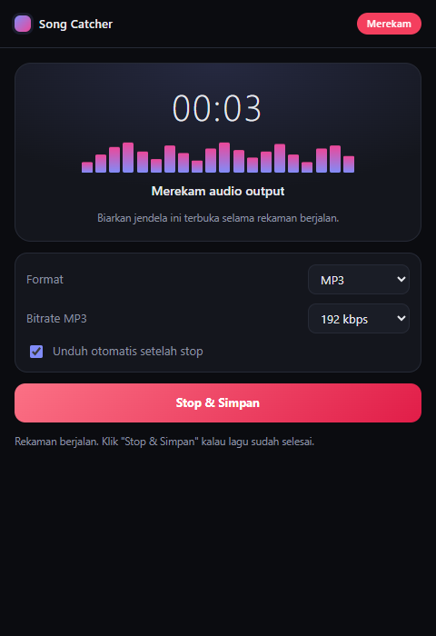

# Sound Catcher

Rekam audio yang keluar ke speaker atau headphone, lalu simpan sebagai **WAV** atau **MP3**. Ada dua bentuk: aplikasi Windows native dan ekstensi Chrome.


## Screenshot

<p align="center">
  
  
</p>

<p align="center">
  
</p>

<p align="center">
  
  
</p>

## Kenapa dua bentuk

| | Aplikasi Windows | Ekstensi Chrome |
| --- | --- | --- |
| Sumber audio | WASAPI loopback: apa pun yang keluar ke speaker | layar, jendela, atau tab lewat pemilih Chrome |
| Audio DRM | ikut terekam karena diambil setelah mixing | kosong (Widevine) |
| Butuh dialog pemilih | tidak | ya, setiap mulai merekam |
| Penyimpanan | langsung ke disk | memori lalu IndexedDB |
| Platform | Windows 10/11 | Windows, macOS, Linux |

Aplikasi Windows adalah jalur utama. Ekstensi tetap ada untuk kebutuhan merekam satu tab saja atau memakai sistem non-Windows.

## Fitur

- Rekam audio output tanpa mikrofon, tanpa noise ruangan.
- Ekspor **MP3** 128/192/256/320 kbps atau **WAV** PCM 16-bit.
- Nama file otomatis dari metadata lagu Windows (`Artis - Judul (tanggal).mp3`).
- **Rapikan otomatis**: senyap di awal dan akhir dibuang.
- **Editor potong**: waveform, dua handle, preview, simpan sebagai berkas baru.
- Timer, level meter, dan pemilihan perangkat output.
- Pengaturan tersimpan di `%APPDATA%\SoundCatcher\settings.json`.

## Pakai aplikasi Windows

```
desktop\dist\SoundCatcher.exe
```

1. Pilih sumber audio (bawaan: perangkat output default).
2. Pilih MP3 atau WAV, atur folder simpan.
3. Klik **Mulai Rekam**, putar lagunya, lalu **Stop & Simpan**.
4. Klik **Potong...** kalau ingin memilih bagian sendiri.

Build bawaan framework-dependent, butuh .NET 8 Desktop Runtime. Versi mandiri:

```powershell
.\desktop\publish.ps1 -Standalone
```

Detail lebih lengkap ada di [desktop/README.md](desktop/README.md).

## Pakai ekstensi Chrome

1. Buka `chrome://extensions`, nyalakan **Developer mode**.
2. **Load unpacked**, pilih folder root repo ini.
3. Klik ikon, buka jendela rekam, pilih sumber, dan **centang "Bagikan audio sistem"**.

## Tech stack

**Aplikasi Windows**

| Bagian | Teknologi |
| --- | --- |
| Bahasa dan UI | C# 12, .NET 8, WPF, XAML |
| Capture audio | WASAPI loopback lewat NAudio 2.2.1 (`WasapiLoopbackCapture`) |
| Encoding | NAudio.Lame 2.1.0 (LAME 3.100) untuk MP3, `WaveFileWriter` untuk WAV |
| Metadata lagu | `Windows.Media.Control` (SMTC) lewat WinRT |
| Pemrosesan | konversi float ke PCM 16-bit, deteksi senyap, potong rentang |
| Kontrol kustom | `LevelMeter` dan `WaveformView` (WPF `FrameworkElement`) |
| Pengaturan | System.Text.Json di `%APPDATA%` |
| Build | `dotnet publish`, framework-dependent atau self-contained |

**Ekstensi Chrome**

| Bagian | Teknologi |
| --- | --- |
| Manifest | Chrome MV3, service worker modul |
| UI | HTML, CSS, JavaScript tanpa framework |
| Capture | `getDisplayMedia` + `systemAudio: include` |
| Pemrosesan | AudioWorklet (PCM 4096 sampel) + Web Worker |
| Encoding | lamejs untuk MP3, penulis header RIFF manual untuk WAV |
| Penyimpanan | IndexedDB, unduhan lewat `chrome.downloads` |
| Metadata | `navigator.mediaSession` disuntik dengan `chrome.scripting` |

**Pengujian**

| Berkas | Isi |
| --- | --- |
| `desktop/tests/AudioEngineTest` | rekam nada lewat loopback, uji deteksi senyap, ekspor, dan potong |
| `tools/smoke-test.mjs` | muat ekstensi di Chrome headless lewat CDP, uji encoder dan IndexedDB |

## Struktur repo

```
.
├─ desktop/                  aplikasi Windows
│  ├─ SoundCatcher/          proyek WPF
│  ├─ tests/AudioEngineTest/ uji engine tanpa UI
│  ├─ publish.ps1
│  └─ README.md
├─ docs/screenshots/         gambar untuk README
├─ manifest.json             ekstensi Chrome (MV3)
├─ background.js
├─ popup.html, popup.js
├─ recorder.html, recorder.js
├─ worker/encoder.js         encoder WAV dan MP3
├─ worklet/pcm-capture.js    pengambil PCM
├─ lib/lame.min.js
├─ db.js, downloads.js, ui.css
├─ icons/
└─ tools/smoke-test.mjs
```

## Uji

```powershell
# engine audio aplikasi Windows
dotnet run --project desktop\tests\AudioEngineTest\AudioEngineTest.csproj -c Release

# ekstensi Chrome
node tools\smoke-test.mjs
```

## Batasan

- Aplikasi Windows hanya untuk Windows 10/11.
- Yang direkam adalah semua suara yang keluar ke perangkat itu, termasuk notifikasi.
- Kalau perangkat output berganti di tengah rekaman, rekaman berhenti.
- Saat tidak ada audio sama sekali, Windows mematikan audio engine sehingga tidak ada paket masuk.
- Ekstensi tidak bisa merekam konten ber-DRM.
- Belum ada perekaman mikrofon dan pemisahan otomatis per lagu.

Gunakan hanya untuk konten yang Anda berhak merekamnya.
